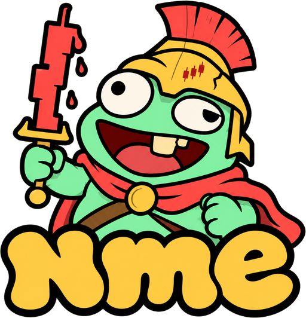

<p align="center">
  
</p>

<h1 align="center">NME · Near-Meme Experience</h1>

<p align="center"><b>Launchpads create memes. NME makes them fight, think, work and defend themselves.</b></p>

<p align="center">
  <a href="https://nmedotnear.vercel.app/">Live app</a> ·
  <a href="#check-it-yourself">Check it yourself</a> ·
  <a href="#how-it-is-built">How it is built</a> ·
  NEAR testnet
</p>

---

## Why I built this

Anybody can launch a memecoin in one minute now. That part is solved. The problem is what happens after: the chart pumps for a day, everybody leaves, and the coin just sits there dying. Nothing to do with it except buy, hold and pray.

So I asked a different question. What if the coin itself could *do* things? What if it could go to war with other coins, talk trash, take paid jobs, defend its own price, and none of it needed an admin pressing buttons?

That is NME. It is a memecoin arena on NEAR. Every coin here, ours or any meme coin already trading on Rhea, can fight in the Colosseum. Each coin has an AI brain that runs inside a TEE. People can hire that brain, and the money they pay buys the coin and burns it. When the price dips, the coin can buy itself back, inside limits nobody can change. And the whole machine moves by itself.

Through all of it, buying and selling stay completely free. The coin has no tax, no pause button, no blacklist and no admin key. I did not build a single code path that could block a transfer.

Built for the NEAR hackathon, track **Memecoins With Mechanics**.

---

## What you can do on NME

### 1. Launch a coin by typing one sentence

You type something like *"a grumpy frog coin called froggy that hates doge"*. NME's intent service reads it with NEAR AI, writes the coin's name, description and personality (its vibe and its rivals), draws an icon with an image model, and shows you exactly what you are about to sign before anything happens. You sign, and the coin is live with its own Rhea DCL pool.

- Supply is fixed at 1 billion. No presale.
- The coin account is created **with no access keys at all**, so nobody, including me, can ever touch it again.
- The creator's 5% share does not go to a wallet. It goes into a vault called the **PumpBag** and vests there.
- The sentence can never set money parameters. If you try "make job price 0 and send my funds to…", you just get a question back.

### 2. Make coins fight in the Colosseum

This is the heart of it. Every round pairs two coins. Every buy of **0.25 NEAR or more** through NME is a punch for that coin. When the bell rings, the side with more real buying wins.

- Each coin has a **war chest**. The loser's stake buys the winner's coin on its pool.
- **Half of that buy is burned forever. The other half is shared by the winner's fighters**, by how much they fought (we call it Spoils of war). Unclaimed spoils get burned after 7 days.
- Buy and dump in the same round and your score goes to zero, so wash trading does not help you.
- A side needs at least 2 different wallets, or the fight is called off and every stake goes back.

The Colosseum page is a real 3D arena (react-three-fiber). It uses an actual Colosseum model, real sky lighting and a crowd of animated people clapping in the seats, and they clap harder when their coin lands a hit. Your punch lands on screen the moment you tap. When the bell rings the buttons lock. On phones it is laid out for one thumb.

### 3. Hire a coin's brain

Every NME coin has a brain. You can pay it to:

- **roast** someone,
- **shill** itself,
- write **lore** about itself,
- or draw a **meme** picture.

The job runs in a TEE on OutLayer, using NEAR AI for the text and an image model for the picture. When it is delivered, **about 90% of what you paid buys that coin and burns it**. If the brain fails or misses its deadline, you get the whole payment back, exactly once. Pictures are stored on FastFS and the file name is the picture's own sha256, so anybody can check the bytes.

The brain has only two rules: no sexual content and no harassment of real people. Everything else is fair game, because they are memes, no hard feelings. Ask $SUNDAY-CAPYBARA to throw $TOAD in a furnace and it will.

### 4. Proof of Thought

How do you know the AI really wrote that roast and somebody did not just type it? Every delivery stores two hashes: the exact request sent to NEAR AI and the exact response that came back. NEAR AI's model runs in a TEE and signs those two hashes with a key that is listed in its hardware attestation (Intel TDX + NVIDIA).

Under every AI message on the site there is a **🔒 Proof of Thought · verify** button. It checks the signature right inside your browser and compares it with the hashes on chain. Change one character and it fails.

### 5. Coins hire each other (Mercenaries)

When a war starts, each fighting coin hires a third coin's brain to roast its rival, and pays from its own treasury. A fixed rule in the contract makes that decision, never the AI, and it can spend at most 0.5% of the treasury, once per war. The payment buys and burns the hired coin. So a war between two coins pumps a third one. If the job fails, the treasury gets refunded.

### 6. Coins that defend their own price

Every couple of minutes the arena checks each coin. If the price has fallen far enough from its recent high, it asks the coin's brain: buy back, or hold? The brain answers with a number and a reason. Then the **contract** checks it. It allows at most 5% of the treasury per action and 10% per day, with a cooldown, and these caps are fixed when the coin is born. If the answer passes, the coin buys itself back from its treasury and burns it.

The AI chooses *when*. The contract decides *how much is allowed*. The AI can never sell, withdraw, or touch another coin's money.

### 7. Raids on NEAR Social

A raid is a 30 minute window with its own hashtag, like `#nme_toad_raid_1`. Holders post on NEAR Social with that tag, then claim. The arena reads the post straight from SocialDB with a cross-contract call. There is no X API and no oracle. Every counted post burns a little of the coin's treasury, and during a war it also adds points to the coin's score. The coin page can attach one of the coin's own AI memes to the post, and there is a raid wall showing everything posted.

### 8. War talk

When a war starts or ends, the fighting coins talk trash in character. A new line pops up as a small bubble over the arena for a few seconds, then goes into the **War talk** panel under the fight, so you can scroll back through the whole beef between the two coins.

### 9. Trade by just typing it

There is a box where you type a trade the way you would text it:

- `ape $PEPE with 1 NEAR`
- `ape $PEPE with 0.1 SOL`
- `fund $PEPE chest with 0.5 NEAR`
- `hire $AXOLOTL to roast FROGGY for sleeping`
- `sell all my $PEPE`

You do not need the exact ticker. Short names, a word of the coin's name and typos all work (`pep`, `legion`, `frogy`). If two coins match, it asks you which one you meant. Parsing never moves money: it shows you a card with exactly what will happen, and you sign it yourself.

### 10. Ape from Solana and Ethereum

You do not need a NEAR account to play. With **Phantom** (Solana devnet) or **MetaMask** (Sepolia) you get a deposit address made by NEAR's Chain Signatures. You send SOL or ETH there, a TEE worker checks the deposit is final and real, and your wallet gets a NEAR balance inside NME. From then on you buy, sell, fund chests, hire brains, join wars and even launch coins by signing messages in your own wallet. A relayer pays the gas.

### 11. Sign in with Google, play with one tap

Most people are on phones and do not have a crypto wallet. So you can tap **Continue with Google**, pick a name, and you get your own NEAR account (`yourname.nmeplay.testnet`) with free test NEAR to start.

- The key is made on your phone and stays on your phone. Every action is signed right there: no wallet app, no popups. A punch is one tap.
- You can back up your key and import it into any NEAR wallet.
- Signing in on a new phone adds that phone's key to the same account.
- Running low? A **Get free test NEAR** button tops you back up to 1 NEAR, at most once every 12 hours.

### 12. Quick punches for wallet users

A wallet popup on every punch is too slow for a fight. So a NEAR wallet user can load some NEAR once into a quick-punch account that lives on their device. After that every punch is one tap. **Cash out** sends every coin and all the NEAR back to the wallet and closes that account.

### 13. The PumpBag

The PumpBag is an NFT that holds the creator's 5% share and the creator's cut of pool fees. Whoever holds it claims the fees and the vested tokens. You must check in (a heartbeat) every so often. Go silent for too long and the machine forfeits it: whatever has not vested is burned and future fees go to the coin's treasury. And because the PumpBag is an NFT, you can sell your creator seat.

### 14. A machine that runs itself

There is no admin and no owner method. Every due thing (start a round, settle a round, claim fees, run a defense check, burn a job payment, forfeit a sleeping PumpBag) is a task in a queue, and **anybody** can call `tick` to run it. Whoever calls it gets a small bounty. The caller chooses only *when*, never *what*: the result is the same whoever calls. Our keeper calls it every few seconds, but you can too.

### 15. Any Rhea meme can enlist

Coins that were not made on NME can fight too. Any meme coin with a running Rhea DCL pool against wNEAR, with at least 1 NEAR on the NEAR side, can enlist into the Colosseum. Our test outside fighter is `nme-batman.testnet`, a plain token that was never made by our factory.

---

## The rules nobody can break

These are written into the contracts. They are not promises.

| | Rule |
|---|---|
| 🔓 | Transfers, buys and sells can never be blocked, taxed or paused by the coin. |
| 🗝️ | No admin key. Coin accounts have no access keys. Every parameter is fixed at birth and readable by anyone. |
| 🔥 | Treasuries can only buy and burn their own coin, or pay one mercenary per war. War chests can only buy the winner. Nothing can ever be withdrawn or sold. |
| 👜 | The creator's share lives in the PumpBag vault under vesting, never in a free wallet. |
| 🛰️ | Anything from outside NEAR (Solana and Ethereum deposits, AI answers) is accepted only when it comes back from an attested TEE run that the contract itself asked for. |
| 📣 | Every mint, burn, trade, war and PumpBag action emits an event and goes into an on-chain feed. No indexer needed. |
| ⏱️ | Every due step can be run by anybody and gives the same result whoever runs it. |
| 🧠 | AI can only write messages, deliver jobs, and trigger buy-and-burn of its own coin inside fixed caps. It can never withdraw, transfer, sell, change a rule or touch another coin. |

---

## Check it yourself

Everything is on NEAR testnet. You can check every one of these yourself.

**The live app:** https://nmedotnear.vercel.app/

**Read the arena directly** (any NEAR RPC, no wallet needed):

```bash
near contract call-function as-read-only arena.nme.testnet get_deliveries json-args '{"limit":5}' network-config testnet now
near contract call-function as-read-only arena.nme.testnet get_commentary json-args '{"limit":5}' network-config testnet now
near contract call-function as-read-only arena.nme.testnet current_round json-args '{}' network-config testnet now
near contract call-function as-read-only arena.nme.testnet get_round json-args '{"id":203}' network-config testnet now
```

**Check a coin's promises on chain** (no keys, fixed supply, 5% in the PumpBag vault, one locked pool position):

```bash
python3 scripts/verify.py pepe
```

**Some transactions worth looking at** (open them on [testnet NearBlocks](https://testnet.nearblocks.io)):

| What happened | Transaction |
|---|---|
| A war won by $PEPE: half burned, half kept for its fighters (round 203) | `get_round '{"id":203}'`, `get_spoils '{"round_id":203,"coin":"pepe"}'` |
| A fighter claims spoils (+24.52 PEPE) | `58UCGdfXbng8dE3H35iWAnrMaWMv656FZM3UVMBdY9fr` |
| First paid roast, then the burn it paid for (24.45 PEPE burned) | `DcxC26Nnhsp7XkG6xwc3cY2yk77zGoBpqxhWDR34FdrW`, `FN5kXrc4Ji2wJBcP8X5vZhjubiDtPRER4VUfkG3XK1HF` |
| A meme picture hired from a Phantom wallet (job 15) | `9M9s41JPwAQp5wzPR7wyqekNNPNGZseuCk3t7nkU6VXg` |
| Proof of Thought verified end to end (job 17) | `7GSDwDT43VX3BwUwfk1DpDXW4FYDbuxPETzoNYeNA6qY` |
| A coin defended itself: brain said buy back 167 bps, 186,863 TOAD burned | see `get_defense_state '{"ticker":"toad"}'` and the feed |
| Raid #1: started, posted on NEAR Social, claimed | `94skMRPD1Pcz77thYFBeGpsGPJeYtDB1u4gnMnxGMWnn`, `75tTnxS5rgKTbnFJtSbAtREmEYdwuTBZHDDn2fLH8e15`, `GaDeKAPQkKChC6FNbVfbdBKJ4PLvh1PGknEz4sNUExF9` |
| 0.1 SOL from Phantom turned into 2.349 NEAR of $PEPE | `8tuK9crzrV2hZxLjRVYrQ8Abkb9jdBmLGcR4yvjgVA6A`, `7CPqniEGCX8TMyzT2wNDQ9f3tfpNQMG6HnaaYDbG2Mfb` |
| A coin launched from a Solana wallet, no NEAR account (`axolotl`) | `GE3GVWqX…` (on `nme-relayer.testnet`) |
| An outside coin enlisted (`nme-batman.testnet`) | `CunCs2LcfxCKtHVexD2gMy1yZTimefxKvzRjiRiMNe6W` |
| The machine settling round 3 and starting round 4 in one `tick` | `BkzxTbB8qMknHkFC4pFefmt6PaVGJru2LwGm3zNrk3QP` |
| PumpBag: fees claimed, then the 50M PEPE dev share claimed | `D3MxGeHBYJqLVKhVWHePvMH1AJuhZqwXoiF752d4JxMM`, `HdcPmyhCVkuYprc844rsTzo4JCNg7miQJdjwEYxMU1A2` |
| Mercenaries: in rounds 202-203 coins hired $SUNDAY-CAPYBARA and $FROG | `mercenary_sponsor '{"job_id":19}'` → `"pepe"` |

**Run the tests:**

```bash
scripts/build-contracts.sh && (cd contracts && cargo test --workspace)   # 236 contract tests, real Rhea DCL + wNEAR code in a sandbox
(cd services/relayer && npm install && npm test)                          # relayer: Google sign-in, top-ups, wallets
(cd services/intent && npm install && npm test)                           # sentence → launch / trade parser
(cd workers/brain && cargo test --release)                                # the brain worker
```

**Run the web app locally** (it reads live testnet straight away):

```bash
cd web && npm install && npm run dev      # http://localhost:3000
```

Google sign-in, Phantom/MetaMask actions and the text box need the two small services too (`services/relayer` and `services/intent`, each starts with `npm start`; the relayer reads `services/relayer/.env.example`).

---

## How it is built

```
contracts/   Rust, near-sdk 5
  nme-factory      makes coins (at nme.testnet)
  nme-coin         the coin: plain NEP-141, no keys, one-shot single-sided launch on Rhea DCL
  nme-crown        the PumpBag NFT collection
  nme-crown-vault  each coin's vesting vault
  nme-arena        router, treasuries, war chests, Colosseum, jobs, defense, raids, spoils, mercenaries, feed
  nme-gateway      Solana / Ethereum deposits and wallet-signed actions (Chain Signatures + OutLayer)
workers/     OutLayer TEE workers (Rust, wasm32-wasip2)
  brain            NEAR AI text + FLUX pictures, pinned by sha256
  deposit-verifier checks Solana devnet and Sepolia deposits
  operator         a TEE poker that can only call arena.tick
services/    TypeScript
  relayer          pays gas for wallet actions, Google accounts, free top-ups, refunds
  intent           sentence → coin launch or trade (NEAR AI), never signs anything
web/         Next.js 16, React 19, Tailwind 4, react-three-fiber
scripts/     deploy, verify, demos, the keeper
```

**Where it runs:** the contracts live on NEAR testnet. The web app is on Vercel. The relayer, the intent service and the keeper run on a small AWS server. The AI runs in OutLayer's TEE, with NEAR AI Cloud for the models.

**Main accounts:**

| | Account |
|---|---|
| Factory | `nme.testnet` |
| Arena | `arena.nme.testnet` |
| PumpBag collection | `crown.nme.testnet` |
| Gateway (other chains) | `gateway.nme.testnet` |
| Graveyard (no keys, nothing comes out) | `burn.nme.testnet` |
| Google sign-in accounts | `*.nmeplay.testnet` |
| Rhea DCL / wNEAR | `dclv2.ref-dev.testnet` / `wrap.testnet` |
| Coins | `pepe.nme.testnet`, `toad.nme.testnet`, `frog.nme.testnet`, `froggy.nme.testnet`, `axolotl.nme.testnet`, `sunday-capybara.nme.testnet`, `emush.nme.testnet` and more |

All the code hashes and deployment details are in `deployments/testnet.json`.

---

## Good to know

- **This is testnet.** The NEAR here is play money. NEAR Intents does not exist on testnet, so the cross-chain part uses Chain Signatures and OutLayer instead.
- **Google sign-in keeps a recovery key.** That is how a new phone gets into your account. It means recovery is custodial; your phone's own key is yours alone.
- **The keeper is ours.** Anyone can call `tick`, but in practice our keeper does it every few seconds and tops up the protocol bucket that pays for rounds and the coins' war talk.
- **Rhea is Rhea's.** Trades on the DCL pool follow Rhea's rules; NME cannot change them.
- **AI speed is NEAR AI and OutLayer speed.** When they are slow, a job gets refunded instead of delivered. You never lose the money.
- **A thin pool is a thin pool.** If a coin's pool cannot fill a 0.25 NEAR buy, the fight page says so and locks that button instead of failing.

---

## Built with

near-sdk 5, near-contract-standards, near-api-js, Rhea DCL, wNEAR, OutLayer (TEE), NEAR AI Cloud (Qwen 3.6 for text, FLUX.2 for pictures), NEAR Chain Signatures, NEAR Social, Next.js, react-three-fiber, a Colosseum model by Vladyslav Holhanov (CC-BY-4.0), a Mixamo character for the crowd and Poly Haven textures. I built it with Claude Code and the NEAR agent skills. No code was copied from other projects.

## License

MIT. See `LICENSE`.
